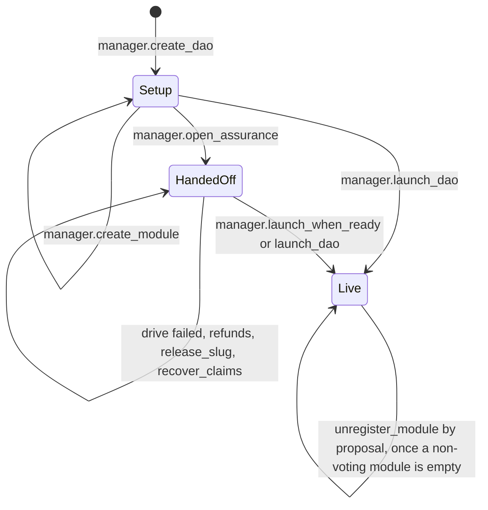
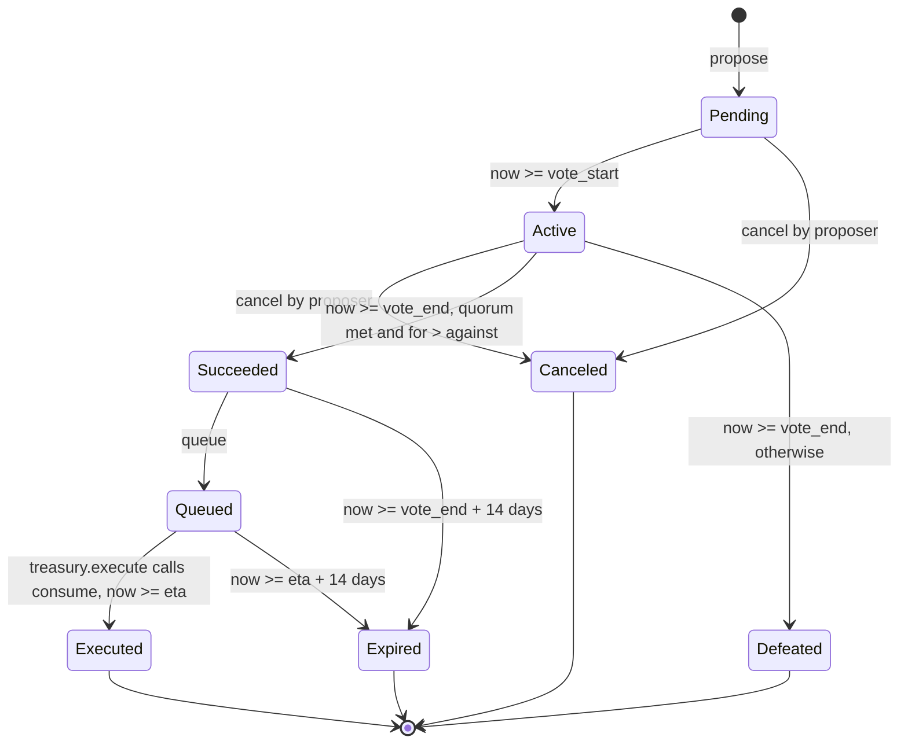
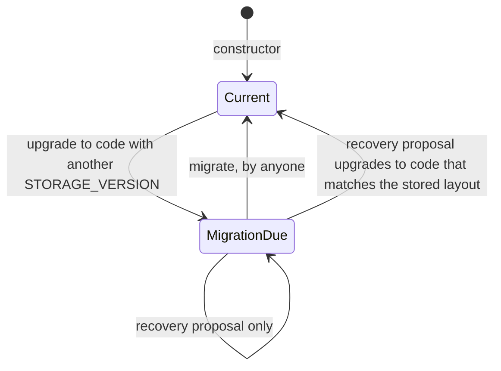
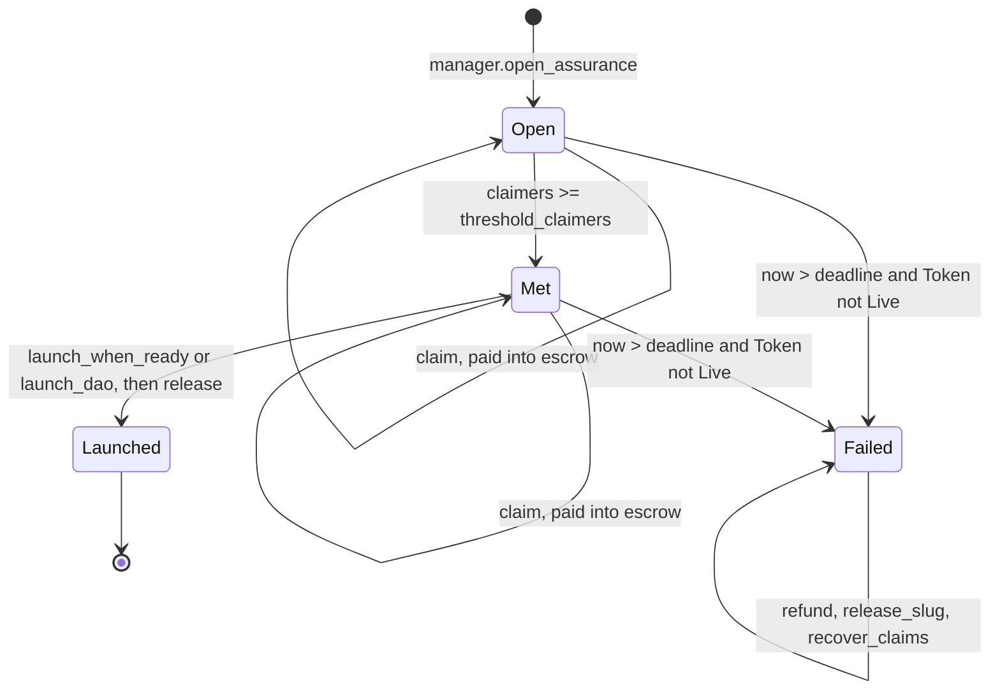
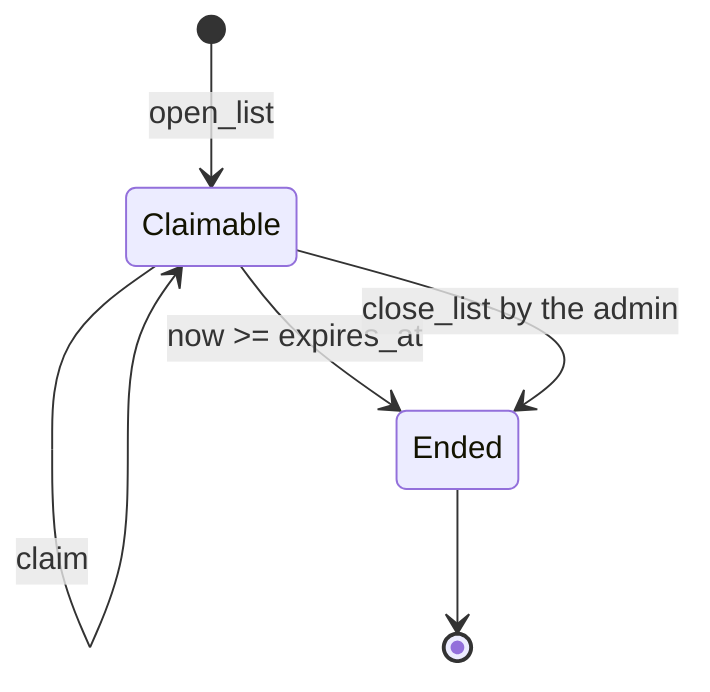
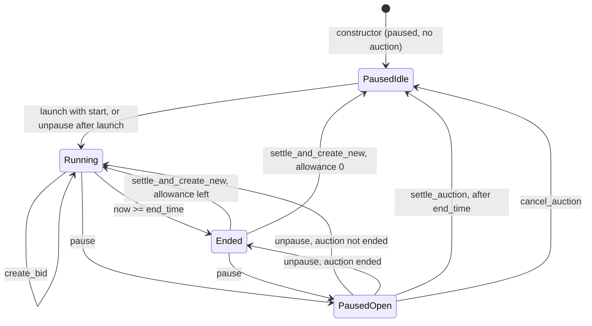
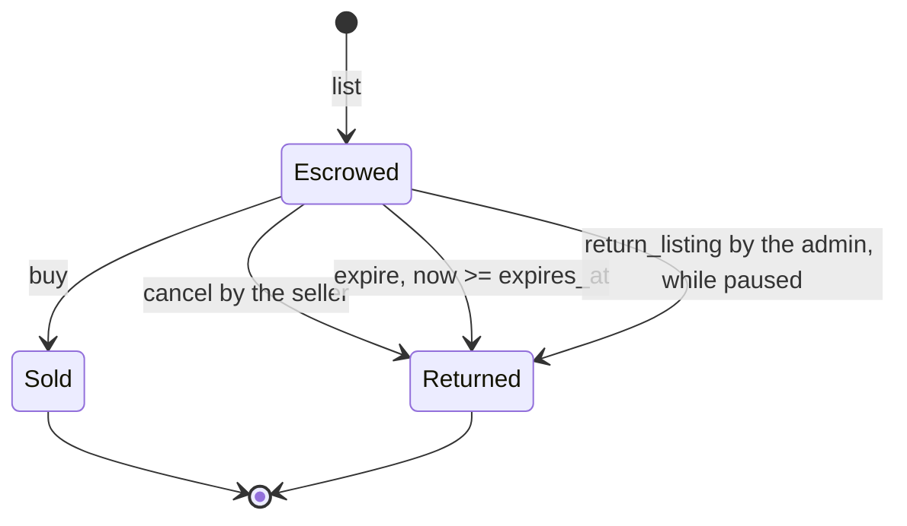
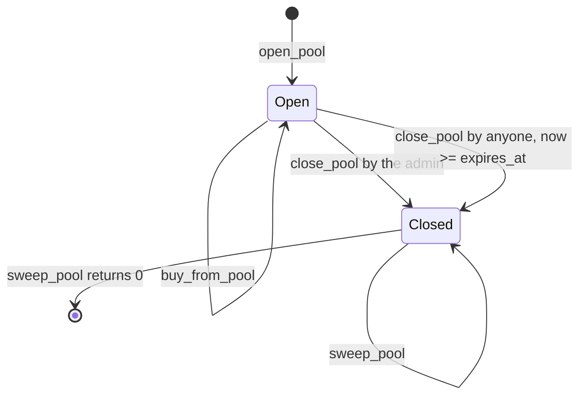

# State machines

These diagrams show the main state machines in the contracts, with their transitions and guards. Each transition names the entry point, who may call it, and what it checks; error names are in brackets, with the code where the project defines it. The Rust source is authoritative: where a diagram and the code differ, the code is right and the diagram is a documentation bug.

The diagrams were checked against `dev` at `f51d301`, which includes pull requests 118 to 130. Times are ledger timestamps in seconds unless a field says it holds a ledger number.

- [Module lifecycle: Setup, handoff, Live](#module-lifecycle-setup-handoff-live)
- [Proposal](#proposal)
- [Storage layout: Governor and Treasury](#storage-layout-governor-and-treasury)
- [Assurance drive and claim lists](#assurance-drive-and-claim-lists)
- [Auction](#auction)
- [Listings](#listings)
- [Quick-buy pools](#quick-buy-pools)

## Module lifecycle: Setup, handoff, Live

Every DAO contract (Token, Metadata, Governor, Treasury, and each Manager-deployed module) holds two pieces of state that decide who can act on it: the `Live` flag ([`common/src/lifecycle.rs`](../../contracts/common/src/lifecycle.rs)) and the admin ([`common/src/admin.rs`](../../contracts/common/src/admin.rs)). The DAO as a whole moves through three states, which the Manager drives for every contract at once.

| State | `Live` flag | Admin of every contract | Who can change settings, mints, and upgrades |
| --- | --- | --- | --- |
| Setup | false | The launch admin | The launch admin, directly |
| HandedOff | false | The Treasury | Nobody: the Treasury acts only through executed proposals, and proposals need `Live` |
| Live | true | The Treasury | The Treasury, by proposal |

A DAO that is never launched stays in Setup, or in HandedOff after a failed drive. There is no transition out of either other than launch.

### Transitions

| Transition | Entry point and caller | Guards |
| --- | --- | --- |
| Create | `manager.create_dao(params)`; the deployer and the launch admin both sign | Factory not paused (`FactoryPaused`, 7111); a valid initial config; every module's payment asset a Stellar Asset Contract (`InvalidPaymentAsset`, 7146); slug not held by a launched DAO; the factory's current hash set and not revoked for every contract it deploys; an outside vote source approved. Deploys the core four and the modules named in the params, each with the launch admin as admin, and registers the modules in the Token's registry |
| Add a module | `manager.create_module(token, spec, expected_n)`; the Token's admin: the launch admin in Setup, the Treasury by proposal once Live | Factory not paused; the DAO is pending or launched (`DaoNotFound`); `expected_n` equals the number of modules of that kind created so far (`StaleModuleIndex`); a valid spec, with a payment asset that is a Stellar Asset Contract (`InvalidPaymentAsset`, 7146), on the factory's current hash. In Setup the Manager also registers the module in the Token's registry, and only the Manager can ([`token` `require_registrar`](../../contracts/token/src/contract.rs)). For a launched DAO it deploys the module with the Treasury as admin and launches it at once, closed; the Treasury registers it by a separate proposal |
| Remove a module | `token.unregister_module(address)`; the registrar: the Treasury by proposal once Live. In Setup only the Manager is the registrar, and it never calls this | A registered module (`NotAModule`); a non-voting module holds no tokens (`ModuleHoldsTokens`, 7222). Sets the module's allowance to zero and removes it as a transfer agent. A voting module may leave while holding tokens, because they already count as votes. To empty the Auction first: `pause`, then `cancel_auction` (or `settle_auction` once ended) and `recover_token`. To empty the Marketplace: `pause`, then `return_listing` for each listing, `close_pool` and `sweep_pool` for each pool, and `recover_token` |
| Configure | Admin-gated setters on each contract; the admin | `common::admin::require_admin`. The same setters serve the Treasury after launch |
| Hand off | `manager.open_assurance`; the launch admin | See [Assurance drive](#assurance-drive-and-claim-lists). Calls `handoff(treasury)` on every contract: Manager authorization, Setup only (`AlreadyLive`, 7002), `treasury` equal to the one wired at construction (`TreasuryMismatch`). The Treasury's `handoff` also needs its storage layout current (`StorageVersionMismatch`, 7607) |
| Launch | `manager.launch_dao(token, config)`; the launch admin. `manager.launch_when_ready(token)`; anyone, during a drive | In this order: factory not paused; the code each core contract and each registered module runs, read with `address.executable()` rather than the hash a contract reports, registered and not revoked, checked before the Manager calls into any of them (`PendingDaoUsesRevokedImplementation`, 7121); without a drive, the launch admin is still the Token admin (`LaunchAdminNotOwner`, 7126); with a drive, not failed (`AssuranceFailed`) and `Met` (`AssuranceNotMet`); slug still free unless the drive holds it (`SlugTaken`, 7123); voting supply above zero (`LaunchSupplyZero`, 7120); an outside vote source approved and nonzero; each module's payment asset equal to the one recorded at creation (`PaymentAssetMismatch`). Launch does not check again that a recorded payment asset is a Stellar Asset Contract |

`launch` runs on the Token, Governor, Treasury, every registered module, and then Metadata, in one transaction. Each call is Manager-only and one-shot: `common::lifecycle::mark_live` fails with `AlreadyLive` (7002) on a second call. Each also hands the admin to the Treasury unless the drive already did (`handoff_once`), so no contract leaves launch with another admin. If any step fails the whole launch reverts and every contract stays in its previous state. During a drive, `launch_dao` uses the launch config stored at `open_assurance` rather than the one passed in.

In Setup, only the admin and the ClaimMinter can mint: the Token refuses every other module until launch (`MintAuthorityNotAllowed`, [`spend_mint_authority`](../../contracts/token/src/contract.rs)). Live-only entry points fail with `NotLive` (7001) before launch; see the table in [`docs/SECURITY_MODEL.md`](../SECURITY_MODEL.md#lifecycle-setup-window-and-launch).

After launch, the Manager holds no authority over the DAO's contracts. It still deploys a module the Treasury asks for, but only the Treasury can register it. The Treasury may also register a contract the Manager never deployed; such a module has its own lifecycle and is never launched by the Manager.

In the HandedOff state, one contract can still change: after a failed drive, the launch admin can upgrade the ClaimMinter with `manager.recover_claims`. The Manager's upgrade-notice rule applies to it: only to the hash announced as latest for its name, and only once the notice has passed since the approval, since the announcement, and since the drive's deadline, with a seven-day floor ([Assurance drive](#assurance-drive-and-claim-lists)).

## Proposal

The Governor ([`governor/src/contract.rs`](../../contracts/governor/src/contract.rs)) stores four states: `Pending`, `Queued`, `Executed`, and `Canceled`. `Active`, `Succeeded`, `Defeated`, and `Expired` are computed from the clock and the tally whenever the state is read (`proposal_state_internal`), so they need no transaction.

| Entry point | Caller | Guards and effect |
| --- | --- | --- |
| `propose(targets, functions, args, description, proposer)` | Any account that holds enough votes | The storage layout current, or a recovery proposal ([below](#storage-layout-governor-and-treasury)); `Live` (`NotLive`, 7001); proposer authorization; proposer's votes at the snapshot (the previous ledger) at least the threshold (`InsufficientProposerVotes`). The threshold is capped at the voting supply at the snapshot and never below 1 (`votes_needed_to_propose()`); 1 to 20 actions (`EmptyProposal`; `TooManyActions`, 7508); matching lengths; description within the OpenZeppelin limit; no action that calls this Governor's `consume` (`CannotConsume`, 7516); the estimated contract events of the whole execution within `common::EXECUTION_EVENT_BUDGET`, 15,500 bytes (`MintsTooLarge`, 7517); id not already used (`ProposalAlreadyExists`). Sets `vote_start = now + voting_delay`, `vote_end = vote_start + voting_period`, fixes the quorum, `ceil(voting_supply × quorum_bps / 10,000)` from the supply at the snapshot, and sets the proposal's TTL to 120 days |
| `cast_vote` | Any account with votes at the snapshot | The storage layout current, or the proposal marked as a recovery proposal; `Live`; voter authorization; state `Active` (`ProposalNotActive`); weight at the snapshot above zero (`ZeroVotingWeight`, 7512); one vote per account and a known vote type (OpenZeppelin `count_vote`: `AlreadyVoted`, `InvalidVoteType`) |
| `queue` | Anyone | The storage layout current, or a recovery proposal; `Live`; state `Succeeded` (`ProposalNotSuccessful`, `ProposalAlreadyExecuted`). Sets `eta = now + queue_delay` and renews the proposal's TTL to 120 days |
| `treasury.execute` then `governor.consume` | Anyone calls `execute`; `consume` requires the Treasury's authorization | Each contract's storage layout current, or a recovery proposal; `Live`; state `Queued` (`ProposalNotQueued`, `ProposalAlreadyExecuted`); `now >= eta` (`ProposalNotReady`, 7513). Marks the proposal `Executed`; the Treasury then runs each action in order, and refuses an action, or a node of an `authorize` tree, that calls the Governor's `consume` (`CannotConsume`, 7606). If any action fails, the whole transaction reverts, including the `Executed` mark, and the proposal stays `Queued` |
| `cancel` | The proposer only | The storage layout current; proposer authorization (`ProposalNotCancellable` for anyone else); state `Pending` or `Active` |
| `governor.execute` | Anyone | Always fails (`UseTreasuryExecute`, 7507) |

The voting delay, voting period, and queue delay are each 300 seconds to 30 days. The longest lifecycle is therefore 118 days: 30 days each of voting delay and voting period, 14 days to queue, a 30-day queue delay, and 14 days to execute. `propose` covers the first stage (up to 74 days) and `queue` the second (up to 44), each with a 120-day TTL; compile-time checks in [`governor/src/storage.rs`](../../contracts/governor/src/storage.rs) keep each stage within the TTL even if ledgers close every 4 seconds rather than 5. A Governor without `votes_needed_to_propose` (0.5.0 and earlier) applies the configured threshold uncapped.

Because no proposal can call `consume`, a proposal reaches `Executed` only through `treasury.execute` running its own actions, and a queued proposal cannot be cancelled by consuming it.

## Storage layout: Governor and Treasury

The Governor and the Treasury check their stored storage version against their code's `STORAGE_VERSION` (`common::upgrade::is_current_layout`, [`common/src/upgrade.rs`](../../contracts/common/src/upgrade.rs)). While the two differ, a migration is due and only a recovery proposal can run.

A **recovery proposal** is one whose every action is `upgrade` or `migrate` on the DAO's own Governor or Treasury. `propose` marks it with a `RecoveryProposal(id)` key while a migration is due, and only marked proposals take votes during that time.

| Entry point | While a migration is due |
| --- | --- |
| Governor `propose`, `queue`, `consume` | Only a recovery proposal (`StorageVersionMismatch`, 7518) |
| Governor `cast_vote` | Only on a proposal marked as a recovery proposal (7518) |
| Governor `cancel`, `comment`, setters, `launch`, `handoff` | Refused (7518) |
| Treasury `execute` | Only a recovery proposal (`StorageVersionMismatch`, 7607) |
| Treasury `launch`, `handoff` | Refused (7607) |
| `upgrade`, `migrate`, and the views on both | Outside the gate. `migrate` needs no authorization on these two modules and runs the installed code's migration once (`NothingToMigrate`, 7012, when the stored version is not older) |

The Governor upgrades and migrates in one proposal. The Treasury runs a proposal on the code it started with until the proposal ends, so it migrates in two steps: a proposal that only upgrades it, then anyone calls `treasury.migrate()`. If a release's `migrate` fails, the DAO recovers by a recovery proposal that upgrades to a fixed release on a path the Manager admin approved. The Manager does not record storage versions, so it cannot refuse a path to a lower `STORAGE_VERSION`; see [Upgrade path and migrations](../SECURITY_MODEL.md#upgrade-path-and-migrations). The other modules keep an admin-only `migrate` and do not check the layout.

## Assurance drive and claim lists

An assurance drive is a paid claim list that must reach a number of distinct claimers before a deadline for the DAO to launch. The Manager records the drive ([`manager/src/contract.rs`](../../contracts/manager/src/contract.rs) `open_assurance`, `launch_when_ready`, `release_slug`, `recover_claims`); the ClaimMinter holds the list and the escrow ([`minter/src/contract.rs`](../../contracts/minter/src/contract.rs)).

`assurance_state(list_id)` computes `Failed` first (the deadline has passed and the Token is not Live), then `Met` (at least `threshold_claimers` distinct addresses have claimed), otherwise `Open`. The Manager uses the same failure rule itself (`drive_failed`) and reads only `Met` from the ClaimMinter. `Launched` is not a stored state: it is the Token being Live.

| Entry point | Caller | Guards and effect |
| --- | --- | --- |
| `manager.open_assurance(token, list, launch_config)` | The launch admin | Factory not paused; no drive yet (`AssuranceExists`); the code every core contract and registered module runs registered and not revoked, as at launch (`PendingDaoUsesRevokedImplementation`, 7121); the launch admin is still the Token admin; a ClaimMinter is registered (`NoClaimMinter`); the recorded claims payment asset a Stellar Asset Contract (`InvalidPaymentAsset`, 7146); `deadline` at most 90 days away (`DeadlineTooFar`); slug free (`SlugTaken`). The ClaimMinter's `open_list` then checks the terms: price not negative, `total` above zero, `expires_at` in the future, an `ipfs://` tree URI, `threshold_claimers` from 1 to `total` and `deadline` between now and `expires_at` (`InvalidAssurance`, 7825), the payment asset recorded at creation, artwork present, and one assurance list per ClaimMinter. Grants the ClaimMinter `total` more mint allowance, claims the slug, and hands every admin to the Treasury |
| `claim(list_id, claimer, leaf_amount, mint_now, proof, max_price)` | The claimer named in the list | Claimer authorization; before `expires_at` (`ListExpired`); drive not failed (`AssuranceFailed`); price at most `max_price` (`PriceAboveMax`); `mint_now` from 1 to `MAX_BATCH_MINT` (43); a valid Merkle proof for `(claimer, leaf_amount)` (`MerkleProofInvalid`); the claimer's total within `leaf_amount` (`AlreadyClaimed`); the list's total within `total` (`ListSoldOut`); the ClaimMinter's mint allowance (Token errors propagate). Before launch the payment goes into the list's escrow; after launch it goes to the Treasury. A claimer's first claim adds one to `claimers` |
| `launch_when_ready(token)` | Anyone | Every launch guard in the [module lifecycle](#module-lifecycle-setup-handoff-live), with the stored launch config. The launch calls `release` in the same transaction |
| `release(list_id)` | Anyone | Token Live (`TokenNotLive`). Moves the list's whole escrow to the Treasury wired at construction and sets it to zero |
| `refund(list_id, claimer)` | Anyone; the funds go only to the claimer | The list is the assurance list (`NotAssurance`); the drive failed (`NotFailed`); the claimer has escrow (`NothingToRefund`). Sets the claimer's escrow to zero, subtracts it from the list's escrow, and pays it back to the claimer. If the claimer cannot receive the asset, the call fails and the escrow stays until a later call succeeds. The claimer keeps the tokens, which carry no power because the DAO never goes Live |
| `manager.release_slug(token)` | Anyone | The drive failed (`AssuranceNotFailed`); the slug is still held by this DAO (`SlugNotFound`) |
| `manager.recover_claims(token, from_hash, to_hash)` | The launch admin recorded for the pending DAO | The drive failed by the Manager's rule (`AssuranceNotFailed`); the registry approves `from_hash` to `to_hash` (`InvalidUpgradePath`); `to_hash` is the hash the registry announces as latest for its name (`latest_pointer`; `UpgradeNotLatest`, 7131); the notice has passed since the later of the approval and the announcement (`upgrade_delay()` ledgers, never fewer than seven days of ledgers, `MIN_RECOVERY_NOTICE_LEDGERS`) and since the deadline (the same notice at five seconds a ledger, never less than seven days, `MIN_RECOVERY_REFUND_WINDOW`; `UpgradeDelayNotElapsed`, 7130). Calls the ClaimMinter's `recovery_upgrade`, which needs the Manager's authorization and Setup |

Because `release` needs the Token Live and `refund` needs it not Live, the two can never both pay out from the same drive. The notice rules give members at least seven days after a drive fails, and after each recovery target is announced, to take their refunds with the code in place.

Only `claim` puts assets into escrow, and only `release` and `refund` take them out. An asset sent to the ClaimMinter directly is in no escrow, and no function moves it.

### Claim lists in general

Every claim list, assurance or free, follows the same shorter lifecycle:

`open_list` is admin-only: the launch admin in Setup (a priced or assurance list also needs the Manager's authorization, so it comes through `open_assurance`), the Treasury by proposal once Live, where assurance terms are refused (`AssuranceNotAllowed`). A free list opened in Setup stays claimable after launch until it ends. `close_list` sets `expires_at` to now and emits `ListClosed`; it refuses a list that has already ended (`ListExpired`) and the assurance list before launch (`AssuranceNotAllowed`).

Every list draws on the ClaimMinter's one mint allowance on the Token. A free list opened in Setup can therefore use allowance that `open_assurance` granted for the drive, and a claim fails with the Token's `AllowanceExceeded` once the allowance is spent, even before a list reaches its `total`.

A leaf is `sha256(claimer_xdr || leaf_amount as big-endian u128)`, and an internal node is `sha256(min(a, b) || max(a, b))`. [`contracts/minter/test-vectors/merkle-v1.json`](../../contracts/minter/test-vectors/merkle-v1.json) pins this format; the ClaimMinter's tests and the web's tree builder tests both check it.

## Auction

The Auction ([`auction/src/contract.rs`](../../contracts/auction/src/contract.rs), [`helpers.rs`](../../contracts/auction/src/helpers.rs)) sells one new token at a time. It starts paused, holds at most one auction, and keeps a separate pause flag (OpenZeppelin `pausable`).

`PausedIdle` covers both "no auction yet" and "last auction settled or cancelled". `Ended` is computed: the auction is unsettled and `now >= end_time`.

| Entry point | Caller | Guards and effect |
| --- | --- | --- |
| Constructor | The Manager's `create_dao` or `create_module` | The payment token a Stellar Asset Contract (`NotStellarAsset`, 7419). Starts paused, in Setup |
| `launch(treasury, start)` | The Manager | One-shot (`AlreadyLive`); Treasury matches. With `start`, unpauses and creates the first auction, which mints the token into the Auction's custody |
| `unpause(caller)` | The admin (the Treasury after launch) | `Live`; admin authorization (`Unauthorized`). Creates a new auction if there is none or the last one is settled; with no mint allowance left, the mint fails and the Auction stays paused |
| `pause(caller)` | The admin | Admin authorization |
| `create_bid(bidder, token_id, amount, comment)` | Any bidder | Not paused; bidder authorization; the current token (`InvalidTokenId`); `now < end_time` (`AuctionOver`); the first bid at least the reserve (`ReservePriceNotMet`), later bids at least the previous bid plus the minimum increment (`MinBidNotMet`). Takes the bid, refunds the previous leader, and extends `end_time` to `now + time_buffer` when less than the buffer remains, a bounded number of times |
| `settle_and_create_new()` | Anyone | Not paused; not settled; `now >= end_time` (`AuctionActive`, 7404). Marks it settled, sends the token to the winner and the bid to the Treasury (or the token to the Treasury if there was no bid), then creates the next auction. If the Token's mint allowance for the Auction is 0 (cut by a proposal, or a finite allowance used up), it pauses the Auction instead, so the settlement still completes |
| `settle_auction()` | Anyone | Paused; the same checks as above, without creating a new auction |
| `cancel_auction()` | The admin | Paused; not settled (`AuctionSettled`). Refunds the leader, marks it settled, and sends the token to the Treasury |
| `recover_token(token_id)` | The admin | Paused; not the token of an auction that has not settled (`TokenInAuction`, 7420). Sends a token someone transferred to the Auction directly to the Treasury |
| `withdraw_refund(bidder)` | The bidder | A credited refund exists (`NoPendingRefund`, 7416) |
| Setters (`set_duration`, reserve, increment, time buffer, and others) | The admin | Paused. `set_payment_token` also needs a Stellar Asset Contract (`NotStellarAsset`, 7419) |

A refund to an outbid leader is pushed; if the transfer fails, the amount is credited and the bidder pulls it with `withdraw_refund`. A pause cannot end a running auction early: settlement on either path needs `now >= end_time`.

## Listings

A listing is a token a holder escrows in the Marketplace ([`marketplace/src/contract.rs`](../../contracts/marketplace/src/contract.rs)) at a fixed price.

| Entry point | Caller | Guards and effect |
| --- | --- | --- |
| `list(token_id, seller, price, expires_at, max_fee_bps, payment_asset)` | The token's owner | `Live`; not paused; price above zero; `expires_at` in the future; seller authorization; the current fee at most `max_fee_bps` (`FeeAboveMax`, 7714); the current asset equal to `payment_asset` (`PaymentAssetMismatch`, 7712); no listing for the token (`ListingExists`); the seller owns it (`NotSeller`). Moves the token into escrow and records the fee and asset in force |
| `buy(token_id, buyer, max_price)` | Any buyer | `Live`; not paused; buyer authorization; listing exists; `now < expires_at` (`ListingExpired`); price at most `max_price` (`PriceAboveMax`, 7715). Pays the recorded fee to the Treasury and the rest to the seller, in the recorded asset, and sends the token to the buyer |
| `cancel(token_id, seller)` | The seller | Seller authorization; the seller recorded on the listing (`NotSeller`). Works while paused. Returns the token |
| `expire(token_id)` | Anyone | `now >= expires_at` (`ListingActive`). Works while paused. Returns the token to the seller |
| `return_listing(token_id)` | The admin: the Treasury, by proposal | Paused (`NotPaused`, 7729); the listing exists (`ListingNotFound`, 7705). Returns the token to the seller with no payment and emits `ListingCancelled` |
| `recover_token(token_id)` | The admin | Paused (`NotPaused`); no listing records the token (`ListingExists`, 7704); no pool left to sweep (`PoolOpen`, 7725). Sends a token someone transferred to the Marketplace directly to the Treasury |

A token in escrow carries no votes, because the Marketplace is a non-voting module; its votes return with it. `return_listing` and `recover_token` let the DAO empty the Marketplace before unregistering it, which the Token refuses while the Marketplace holds tokens ([module lifecycle](#module-lifecycle-setup-handoff-live)). The constructor and `set_payment_asset` accept only a Stellar Asset Contract (`NotStellarAsset`, 7728).

## Quick-buy pools

A pool sells new tokens at a fixed price into the Treasury, within per-buyer and per-period caps.

An open pool past `expires_at` refuses `restock` and `buy_from_pool` (`PoolClosed`) until someone closes it.

| Entry point | Caller | Guards and effect |
| --- | --- | --- |
| `open_pool(...)` | The admin: the Treasury, by proposal | `Live`; not paused; price above zero; `expires_at` in the future; size, `max_per_buyer`, `max_sold_per_period`, and `period_secs` above zero (`InvalidPool`); the asset a Stellar Asset Contract (`NotStellarAsset`, 7728); fewer than the maximum open pools (`TooManyPools`); the Marketplace's mint allowance not reserved by other open pools covers `size` (`AllowanceNotReserved`) |
| `restock(pool_id)` | Anyone | `Live`; open and not expired (`PoolClosed`); stock left to mint (`PoolFullyStocked`). Mints the next chunk into the Marketplace's custody, spending its allowance |
| `buy_from_pool(pool_id, page, token_id, buyer, max_price)` | Any buyer | `Live`; not paused; buyer authorization; open and not expired; price at most `max_price`; the buyer under `max_per_buyer` (`BuyerLimitReached`); the period under `max_sold_per_period` (`PoolRateLimited`); the token in that stock page (`NotInPool`). Pays the price to the Treasury and sends the token to the buyer |
| `close_pool(pool_id)` | The admin at any time; anyone once expired | Not already closed. Lowers the Marketplace's mint allowance by the unminted part of the reservation (`release_mint_allowance`). Unsold stock stays in custody |
| `sweep_pool(pool_id)` | Anyone | Closed (`PoolOpen`). Returns up to a fixed number of unsold tokens to the Treasury per call, until it returns 0 |

Each token sold from a pool adds a vote for its buyer. The per-buyer cap counts addresses, not people.
