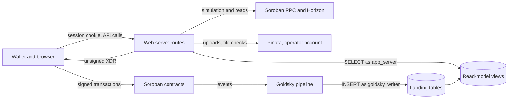

# Threat model: app and indexer tier

This page covers the parts of Tribe Builder that sit between people and the contracts: the web app's server routes (`apps/web`), the Goldsky pipeline (`packages/goldsky`), and the PostgreSQL read model (`db/`). The contracts have their own security model in [`docs/SECURITY_MODEL.md`](../SECURITY_MODEL.md); this tier is out of scope for the contracts audit ([SCOPE.md](SCOPE.md)) and is the subject of a separate, smaller review.

It was checked against `dev` at `f51d301`, which includes pull requests 118 to 130. Where this page and the application sections of `SECURITY_MODEL.md` differ, `SECURITY_MODEL.md` is the reference.

## The rule this tier is built on

**The chain is the authority; this tier is not.** The server holds no key that can move a member's or a DAO's assets, and it never signs or submits a transaction. Every value-bearing action is a transaction the member's wallet signs, and the contracts check it. The server's jobs are to show indexed data, to prepare unsigned transactions, to authenticate wallets for its own routes, and to pay for IPFS uploads. A failure in this tier can mislead a person, deny service, or cost the operator money; it should not be able to move funds without a wallet signature.

## System and trust boundaries

| Boundary | What crosses it | What it relies on |
| --- | --- | --- |
| Wallet to contracts | Signed transactions | The wallet's signature and the contracts' checks. Nothing in this tier is trusted |
| Browser to server | API calls with the session cookie | The session (section 1), the same-origin checks on sign-in and preparation routes, request validation, per-client rate limits (section 5), and the response headers (section 7) |
| Server to Pinata | Upload grants and file checks, billed to the operator | The upload gate (below) |
| Contracts to indexer | Events from contracts the pipeline follows | The allowlists, which start from the Manager's own events |
| Indexer to read model | Rows in three landing tables | The `goldsky_writer` credentials, and the views' filters |
| Read model to server | Indexed state, read as `app_server` | Read-only access; chain re-reads on value-bearing paths |

## Assets

- **Members' and DAOs' on-chain assets.** Protected by wallet signatures and the contracts. This tier can prepare a transaction but cannot sign it.
- **The operator's paid services.** Pinata storage, bandwidth, and API keys.
- **Server secrets.** `IRON_PASSWORD` (the session key, and the upload-token key when `UPLOAD_TOKEN_SECRET` is unset), `UPLOAD_TOKEN_SECRET`, `STELLAR_WEB_AUTH_SECRET` (the SEP-10 and SEP-53 challenge key), `PINATA_JWT`, `APP_DATABASE_URL`, `GOLDSKY_API_TOKEN`, and the pipeline's database credentials. [`docs/KEY_CUSTODY.md`](../KEY_CUSTODY.md) lists where each secret and operator key is held and how to replace it, and [`docs/INCIDENT_RUNBOOK.md`](../INCIDENT_RUNBOOK.md) what to do when one leaks.
- **Read-model integrity.** What people see (DAOs, feeds, balances, listings) and which contract addresses the app prepares calls against.
- **Availability.** Shared views that every DAO's pages read.

## 1. What a session proves

A session is a sealed `iron-session` cookie that records an address, the network it signed in on, and the method used ([`lib/auth/server.ts`](../../apps/web/src/lib/auth/server.ts), [`lib/auth/types.ts`](../../apps/web/src/lib/auth/types.ts)). In production the cookie is `__Host-stellar-auth`, so the browser accepts it only when it is Secure, host-only, and on path `/`; in local development over HTTP it is `stellar-auth`. Both are `HttpOnly` and `SameSite=Lax`.

**Sign-in.** The wallet signs a server-issued challenge: SEP-53 message signing first, SEP-10 as the fallback ([`components/shell/wallet-session.tsx`](../../apps/web/src/components/shell/wallet-session.tsx)). Challenges are signed by the server key, bound to the configured network and app domain, and expire after 5 minutes ([`lib/auth/verification.ts`](../../apps/web/src/lib/auth/verification.ts)). After the signature check, both paths read the account's current signers and medium threshold from canonical Horizon ([`lib/auth/account-signers.ts`](../../apps/web/src/lib/auth/account-signers.ts)). The address's own key (SEP-53) or the challenge's signatures other than the server's (SEP-10) must carry at least the medium threshold, and at least 1, so a master key that was disabled or outweighed cannot sign in. An address with no account yet signs in with its own key's signature, but only on Horizon's authoritative not-found answer; lookup failures, timeouts (8 seconds), and malformed answers return 503. Before the wallet signs a SEP-10 challenge, the browser checks its shape: sequence 0, the server key as source and signer, only manageData operations, and the connected address ([`lib/auth/sep10-proof.ts`](../../apps/web/src/lib/auth/sep10-proof.ts)).

**Who can change the session.** The routes that change who is signed in (both challenges, both verifies, and logout) accept only POST, and only from the app's own pages: `Sec-Fetch-Site: same-origin`, or, from a browser that does not send that header, an `Origin` equal to `APP_URL`. A sibling subdomain is refused, so another page cannot replace or clear a visitor's session. A request with neither header is not from a browser page and carries no visitor's cookie, so it is accepted.

**Lifetime.** A session ends 24 hours after its cookie was last issued. The page-load check (`GET /api/auth/session`) re-issues it at most every 15 minutes, and every session ends 3 days after sign-in. The server keeps no list of sessions, so one session cannot be revoked on its own: logout clears the cookie in that browser, and a copy taken earlier stays valid until one of those limits. `IRON_PASSWORD` may be a JSON map of numbered secrets: adding a higher number rotates the secret without signing anyone out, and removing a number ends every session sealed with it ([`lib/auth/secrets.ts`](../../apps/web/src/lib/auth/secrets.ts)).

What a session lets a caller do:

- **Prepare unsigned transactions** for its own address: the `claims`, `marketplace`, `tokens`, and `treasury` preparation routes under `app/api/dao/[daoId]/*/prepare`. The actor is the session's address, never a submitted one; the request's `Origin` must equal `APP_URL`; bodies are size-capped and validated; and the four routes share a per-client limit of 60 a minute. The result still needs the wallet's signature. Before the app hands any transaction to the wallet, its fee guard refuses one that could charge more than 50 XLM or whose fee it cannot read.
- **Read its own views:** the dashboard, and marketplace and treasury readiness and inventory for its address.
- **Use the upload routes** (section 2).

What a session does not do: it grants no on-chain authority, and it does not show that the account is funded or able to transact.

## 2. The cost of uploads

Uploads to IPFS go through the operator's Pinata account, so each one costs the operator. Every upload route (`/api/pinata/generate-jwt`, `/api/pinata/pin-cid`, `/api/uploads/pinata-url`, `/api/uploads/complete`) passes one gate, `requireUploadAccount` in [`lib/upload-access.ts`](../../apps/web/src/lib/upload-access.ts):

1. a session on the deployment's network;
2. a per-account limit per route in a 10-minute window: `generate-jwt` 10, `pin-cid` 10, `pinata-url` 30, `complete` 30;
3. the account must exist on that network, from canonical Horizon. A failed or timed-out lookup refuses; it never passes. A funded result is remembered for 10 minutes and an unfunded one for a minute.

What this bounds, and what it does not:

- **The unit of cost is an account.** A key costs nothing, but a funded account holds the base reserve on mainnet. On testnet, Friendbot funds accounts for free, so there the funded check costs an abuser one Friendbot call per key.
- **There is no deployment-wide upload budget,** and the limits and the funded cache are kept per server instance (section 5).
- **Upload tokens** are HMAC-signed with `UPLOAD_TOKEN_SECRET` when it is set, otherwise with a key derived from the current (highest-numbered) `IRON_PASSWORD` under its own label, never the session key itself ([`lib/pinata-upload-auth.ts`](../../apps/web/src/lib/pinata-upload-auth.ts)). Changing the secret ends the tokens already issued. A token names the account it was issued to, the upload type, the allowed MIME types, a size limit, and an expiry; only that account completes it, until it expires. It is not single-use and does not name a CID.
- **`complete` and `pin-cid` only read.** The CID must already be a file in the operator's Pinata account, and `complete` checks its size against the token. Neither pins a CID the client names.
- **`generate-jwt`** creates a Pinata key for one legacy `pinFileToIPFS` upload: that endpoint only, `maxUses: 1` ([`lib/pinata-service.ts`](../../apps/web/src/lib/pinata-service.ts)). Pinata keys have no expiry and no size cap of their own; the 100 MB folder limit is checked in the browser. Pinata's documentation states no limit on how many keys an account holds, so the app bounds them by lifetime instead ([`lib/pinata-upload-keys.ts`](../../apps/web/src/lib/pinata-upload-keys.ts)). The pin token names the key under its signature, and `pin-cid` revokes the key once it has checked the upload, whether or not the CID is in the account. Each key's name carries a deadline 15 minutes after it was made, and `generate-jwt` and `pin-cid` revoke this app's keys past their deadline (at most every 5 minutes per instance, 50 keys per sweep). An account that takes keys and never uploads holds only the keys it took in roughly the last 20 minutes (the deadline plus the sweep interval), and the `generate-jwt` limit of 10 per 10 minutes caps how many that is. There is no scheduled sweep: after the last upload call, its keys stay usable for one upload each until the next upload call on any instance. Revocation needs `PINATA_JWT` to be allowed to list and revoke keys; when it fails, uploads keep working and the server logs `[pinata-upload-keys]`. The key calls follow Pinata's API reference and are tested against a mocked Pinata (`app/api/pinata/upload-keys.test.ts`); they have not been run against a live account.
- **Signed upload URLs** from `pinata-url` are short-lived and carry per-type size caps.

The operator's remaining controls are Pinata's own account limits and spend alerts.

## 3. The indexer's trust in outside modules

The pipeline ([`packages/goldsky/pipelines/builder-stellar-events.yaml`](../../packages/goldsky/pipelines/builder-stellar-events.yaml)) follows contracts through append-only allowlist tables in the `streamling` schema:

- The Manager's address is fixed in the pipeline. The DAO's core contracts and its Manager-deployed modules (`auction`, `marketplace`, `claims`) enter the allowlists only from the Manager's `DaoCreated` and `ModuleCreated` events.
- `streamling.dao_modules` takes any contract that a followed Token reports in `ModuleRegistered`. After launch a DAO can register any contract by proposal, so this list can hold code the Manager never deployed.

The read model gives a registration a known role only if the Manager deployed that contract as that kind for the same DAO (`manager.created_modules`, [`db/migrations/0015_known_role_owner.sql`](../../db/migrations/0015_known_role_owner.sql), which replaces the registration views of [`0002_manager_views.sql`](../../db/migrations/0002_manager_views.sql)). Every other registered contract has the role `module`, including a module the Manager built for another DAO, so one DAO cannot present another DAO's market or claim list as its own. A `module`'s events are indexed under its DAO, inside its registration window, with `admin` visibility in the feed. They stay out of the domain views (auctions, pools, listings, claim lists) and out of `manager.daos`. Views that cast event fields read only Manager-deployed roles (`chain.try_int`, migration 0012), and `chain.u64_bigint` reads `u64` values past the bigint range as the bigint maximum (migration 0013), so one contract's malformed or extreme values cannot stop a shared view from reading. A cast in a view's `WHERE` or `JOIN` condition reads only rows its own relation's role condition admits: migration [`0016_condition_casts.sql`](../../db/migrations/0016_condition_casts.sql) gave `governance.proposals`' `proposal_scheduled` join the role condition it lacked, and [Casts in conditions](../DATABASE_SCHEMA.md#casts-in-conditions) lists every such cast and why it is safe. Windows are per DAO, so one DAO's registrations do not add rows to another DAO's views.

What remains is in [KI-15 and KI-16](KNOWN_ISSUES.md#ki-15-outside-modules): an outside module can fill its own DAO's admin feed with noise, rows already indexed stay, and the remedy is to unregister it by vote or remove its allowlist row. [`packages/goldsky/test/module-roles.integration.test.mjs`](../../packages/goldsky/test/module-roles.integration.test.mjs) checks the role rule.

## 4. The `goldsky_writer` role

The pipeline writes to PostgreSQL as `goldsky_writer` ([`db/setup-roles.sh`](../../db/setup-roles.sh), [`db/grant-permissions.sh`](../../db/grant-permissions.sh)).

- **Tables it writes.** Its table privileges are `SELECT`, `INSERT`, and `UPDATE` on the three landing tables: `chain.raw_events`, `chain.decoded_events`, and `app.activity_feed_events`. A trigger makes them append-only: it rejects any `UPDATE` that changes a row and every `DELETE` ([`db/migrations/0001_landing_tables.sql`](../../db/migrations/0001_landing_tables.sql)). Re-delivering an identical row is allowed, so the pipeline can retry. The landing tables are owned by the migration role, so the writer cannot alter them.
- **What it can create.** The Goldsky sink issues `CREATE ... IF NOT EXISTS` statements on startup, which PostgreSQL authorizes before it checks whether the object exists. The writer therefore keeps `CREATE` on the `chain` and `app` schemas and on the database. Database-level `CREATE` alone would let it create any schema, extension, or publication, so `grant-permissions.sh` installs an event trigger, `goldsky_writer_ddl_guard`, that refuses each of those the writer runs except the `streamling` schema, and refuses renaming `streamling`. The writer cannot drop or disable the trigger. Creating it needs a superuser (`neon_superuser` on Neon), and the script creates it last, so the other grants stand if that step fails ([`db/README.md`](../../db/README.md)).
- **Everything else is a view** over those tables, so whatever the writer inserts is what every view and page reads.
- **The web app** connects as `app_server`, which has `SELECT` on the view schemas only, no access to `chain`, and no `SELECT` on `app.activity_feed_events`.
- **Credentials.** `setup-roles.sh` sets each role's password with psql's `\password`, so only its SCRAM hash is sent, and `--rotate <role>` replaces one. The database scripts read the connection URL from `DATABASE_URL` only and never pass it in a process's arguments.

So the writer's credentials are a trust root for display: whoever holds them can append rows that the views will show, though not change or remove rows already there. They cannot touch the chain. This is why the value-bearing paths re-read chain state (section 6), and why the read model is never the authority for a transaction.

## 5. Replay and rate-limit state per instance

Server-side bookkeeping lives in each server instance's memory, not in a shared store:

- the SEP-53 and SEP-10 challenge set that stops a signed challenge from being used twice ([`lib/auth/server.ts`](../../apps/web/src/lib/auth/server.ts)). Sign-in also deletes the challenge from the cookie it returns, so a replay needs the older cookie, within the challenge's 5 minutes, on another instance;
- the sign-in rate limits ([`lib/auth/rate-limit.ts`](../../apps/web/src/lib/auth/rate-limit.ts)) and the API rate limits ([`lib/api-rate-limit.ts`](../../apps/web/src/lib/api-rate-limit.ts)), keyed by route and client address. The API limits cover artwork rendering (300 a minute), transaction preparation (60 a minute, shared), claim state and history (120 a minute, shared), and the health routes and CSP reports (30 a minute); over a limit, a route answers 429 with `Retry-After`;
- the upload limits and the funded-account cache (section 2);
- read caches for DAO configuration, artwork, and claim trees ([`lib/server-cache.ts`](../../apps/web/src/lib/server-cache.ts), [`lib/minter/claim-list.ts`](../../apps/web/src/lib/minter/claim-list.ts)), and a 10-second result cache on each health route.

**The client address** comes from one trusted header: `x-vercel-forwarded-for` on Vercel, or the header `TRUSTED_CLIENT_IP_HEADER` names behind another proxy. Client-supplied `X-Forwarded-For`, `X-Real-IP`, and `CF-Connecting-IP` are otherwise ignored. A header is trustworthy only when a proxy in front of the app sets or overwrites it. Sign-in refuses a production request with no trusted address (503); the API limits do not count such a request, so off Vercel they apply only once `TRUSTED_CLIENT_IP_HEADER` is set. Local development is not counted.

**How much memory each store can hold.** Every store above is bounded, by count, by size, or by its expiry:

| Store | Bound |
| --- | --- |
| Read cache ([`lib/server-cache.ts`](../../apps/web/src/lib/server-cache.ts)): DAO configuration, rendered token images, verified claim lists, chain reads, health results | 2,000 entries and an estimated 128 MB, oldest out first; a single value over 32 MB is returned but not kept. Images are measured in bytes, other values by their JSON length |
| Upload authorizations ([`lib/pinata-upload-auth.ts`](../../apps/web/src/lib/pinata-upload-auth.ts)) | 5,000, oldest out first. The signed token is the record, so a dropped entry still completes |
| Sign-in and API rate limits ([`lib/auth/rate-limit.ts`](../../apps/web/src/lib/auth/rate-limit.ts)), upload limits and the funded-account cache ([`lib/upload-access.ts`](../../apps/web/src/lib/upload-access.ts)) | About 10,000 entries each, expired entries first, then the oldest. Under a flood from more addresses than that, the oldest client's count starts again |
| Claim list failures ([`lib/minter/claim-list.ts`](../../apps/web/src/lib/minter/claim-list.ts)) | 500 |
| Challenge replay ([`lib/auth/server.ts`](../../apps/web/src/lib/auth/server.ts)) | Expiry only: an entry is added only for a server-sealed challenge being checked (removed again if the check fails) or one that signed in, and lives at most the challenge's 5 minutes. Its size follows the rate of sign-ins, which the per-client limits slow. It has no count cap on purpose: dropping an entry would let that challenge sign in again, and refusing new ones when full would let a flood stop sign-in for everyone |

The image library's own cache (sharp) keeps its defaults (50 MB, 100 operations).

On a platform that runs several instances, each counts on its own. A challenge consumed on one instance is not known to another until it expires (5 minutes), and a limit of N per window is N per instance. The limits slow one client down; they do not cap the deployment or stop a distributed flood, which needs the platform's own protection. `SECURITY_MODEL.md` states this: the reference does not claim a shared replay store. The session itself is in the client's cookie, so it does not depend on which instance serves a request.

## 6. What the app re-reads from chain

Addresses and discovery come from the read model; the chain is re-read where a prepared transaction moves value:

| Path | From the read model | Re-read on chain before preparing |
| --- | --- | --- |
| Claims ([`lib/minter/service.ts`](../../apps/web/src/lib/minter/service.ts)) | The DAO's configuration | The ClaimMinter the Token's registry names (`token.module("claims")`); the list, payment asset, allowance, and root; the claimer's record. The claim list file is rebuilt and its root must equal the chain's. Root, price, and progress are checked again after simulation |
| Marketplace ([`lib/marketplace/actions.ts`](../../apps/web/src/lib/marketplace/actions.ts)) | The Marketplace contract and whether it is live | Its wiring (`get_config`) against the indexed Token and Treasury and the configured Manager; the token's owner; the live listing or pool, which must match the indexed one |
| Treasury funding ([`lib/treasury-service/funding.ts`](../../apps/web/src/lib/treasury-service/funding.ts)) | The Treasury and Governor | `treasury.governor()` against the indexed Governor; balances before and after simulation |
| Holder actions ([`lib/token-holder/actions.ts`](../../apps/web/src/lib/token-holder/actions.ts)) | The DAO's contracts | The token's current owner and the Token's settings |
| Proposals | The Governor, Token, and Treasury addresses | The browser builds and simulates `propose` itself; there is no server preparation route |

Display text is checked against the chain where the chain holds a hash: the DAO profile is shown only when the indexed text hashes to Metadata's `profile_hash()`.

## 7. Response headers, member-written content, and server fetches

The full rules are in [`SECURITY_MODEL.md`](../SECURITY_MODEL.md#response-headers), from "Response headers" to "Server-side fetches".

- **Headers on every response** ([`apps/web/security-headers.mjs`](../../apps/web/security-headers.mjs)): `X-Content-Type-Options: nosniff`, `X-Frame-Options: DENY`, `Referrer-Policy: strict-origin-when-cross-origin`, a `Permissions-Policy` that turns off features the app never uses (WebUSB and WebHID stay available for hardware wallets), and `Strict-Transport-Security` (sent by Vercel, or by a production build that runs elsewhere). API responses add `Content-Security-Policy: default-src 'none'; frame-ancestors 'none'`.
- **The page Content-Security-Policy** ([`src/middleware.ts`](../../apps/web/src/middleware.ts), [`lib/content-security-policy.ts`](../../apps/web/src/lib/content-security-policy.ts)) gives each response a fresh nonce, and scripts run only with it (`'strict-dynamic'` for the app's chunks). Images, connections, and frames are limited to the hosts the app and the wallet kit use. The policy is **report-only** until `CSP_MODE=enforce` is set; until then pages enforce `frame-ancestors 'none'`, `object-src 'none'`, `base-uri 'self'`, and `form-action 'self'`. Browsers send violations to `POST /api/csp-report`, which logs a trimmed summary and stores nothing.
- **Member-written content.** Markdown in proposals, comments, and tribe descriptions shows images only from IPFS, through the app's gateways; any other image becomes a link, so an author cannot learn who read the text. Links and image addresses keep only `https:`, `http:`, `mailto:`, and `ipfs:` (`safeMarkdownUrl`, [`lib/safe-url.ts`](../../apps/web/src/lib/safe-url.ts)), and a proposal's discussion link is checked when written and again when read.
- **API errors.** An unexpected failure (the database, the indexer, RPC, or IPFS) answers with a short message and logs the detail on the server ([`lib/api-error.ts`](../../apps/web/src/lib/api-error.ts)); `/api/health` returns a count of pipeline errors, not their text. Sign-in and upload routes keep their own handling.
- **Server-side fetches.** The server fetches remote content in two places, artwork layers and claim lists, both through `fetchPublicUrl` ([`lib/safe-remote-fetch.ts`](../../apps/web/src/lib/safe-remote-fetch.ts)). Every hop, redirects included, must use HTTPS and resolve only to public addresses; the connection is pinned to the checked address; at most three redirects are followed; and the body is size-capped.

## 8. What the wallet shows

Every value-bearing action ends in a wallet signature, so the wallet's screen is the member's last check. For a transaction the server prepared (the `claims`, `marketplace`, `tokens`, and `treasury` `prepare` routes), it is the only check independent of the server. Before the wallet sees such a transaction, the browser checks four things: the source is the connected account, the transaction has not expired, the network matches, and the fee is within the guard ([`lib/marketplace/transaction.ts`](../../apps/web/src/lib/marketplace/transaction.ts), [`lib/wallet-sign.ts`](../../apps/web/src/lib/wallet-sign.ts)). After signing, it checks that the wallet returned the same envelope. It does not decode the call and compare it with the review screen: the check of a marketplace purchase's authorizations runs on the server ([`lib/marketplace/purchase-authorization.ts`](../../apps/web/src/lib/marketplace/purchase-authorization.ts)).

**What the app asks a wallet to sign,** through Stellar Wallets Kit 2.6.0, which passes the wallet only the transaction XDR or the message, with no description:

- **Contract calls:** one `invokeHostFunction` operation, simulated and assembled. The member is the transaction source, so the transaction signature is their authorization (source-account credentials). Anything the call does for them, such as a token `transfer` from their account, is in the transaction's authorization entries.
- **Other operations:** renewals (`extendFootprintTtl`, `restoreFootprint`), and a `changeTrust` before a purchase that needs a trustline.
- **Sign-in:** a SEP-53 message naming the domain, address, network, nonce, times, and the server's key and signature ([`lib/auth/message.ts`](../../apps/web/src/lib/auth/message.ts)), or a SEP-10 challenge of `manageData` operations.

**What the wallets show** for a contract call. This was read from each wallet's source code or documentation on 2026-11-25, without signing anything; screens change between versions.

| Wallet | Shown |
| --- | --- |
| Freighter, renamed Varial in 5.50.0 (extension 5.53.0, and mobile through WalletConnect) | First screen: the requesting site's domain (taken from the browser, not the app), the network, account, total fee, and memo. On mainnet only, a Blockaid scan and the balance changes from its simulation; the transaction and site address go to Freighter's server for these. Behind "Transaction details": "Invoke Contract", the contract ID, the function name, and the parameters, named from the contract's own interface since 5.49.0. Values are raw: an `i128` as digits without decimals, a `Vec` or `Map` entry by entry. "Authorizations" lists the authorization tree, collapsed by function name. It refuses a transaction for another network. For a SEP-53 message: the domain and the message text |
| xBull (public source 1.40.0) | The requester, network, account, fee, and memo. The call appears only as the tree of its authorization entries, with arguments as JSON. Balance changes from its own simulation, for XLM and trustline assets only |
| Albedo | The requesting origin, the network, and each call as `function(arguments)` beside the contract address, with the asset's name when the contract is a Stellar asset contract |
| Ledger (Stellar app 6.1.0) | The contract ID, function, positional arguments, and the authorization tree; transfers of known tokens in plain terms. Every contract call needs the device's blind-signing setting, which is off by default. Freighter sends the device the whole transaction unless the member turned on hash signing |
| LOBSTR, Hana, and the kit's other wallets | Not confirmed from public sources |

Sources: Freighter's [releases](https://github.com/stellar/freighter/releases) and [signing view](https://github.com/stellar/freighter/blob/5.53.0/extension/src/popup/views/SignTransaction/index.tsx); [xBull](https://github.com/Creit-Tech/xBull-Wallet); [Albedo](https://github.com/stellar-expert/albedo); the [Ledger Stellar app's release notes](https://github.com/LedgerHQ/app-stellar/blob/master/release-notes.md); Stellar's guide to [signing Soroban invocations](https://developers.stellar.org/docs/build/guides/transactions/signing-soroban-invocations).

**What no wallet shows:**

- What the call means for the tribe. For example, that a `propose` call's vectors move 500 tokens out of the Treasury, or which tribe a contract belongs to. Contract addresses appear as strkeys without names, and no wallet checks that a contract is the platform's. Freighter's parameter names are the contract author's own labels.
- Amounts with their decimals, apart from known tokens on Ledger and Albedo and Freighter's balance changes on mainnet.
- Nested arguments in a readable form: a proposal's targets, functions, and argument vectors appear as raw structure.
- The storage footprint, or the resource fee as a separate figure.
- With source-account authorization, which is what the app uses, a token transfer the call makes for the member appears only in the authorization tree. In Freighter that tree is collapsed on the second screen.

So the app's review screen carries the meaning, and the wallet confirms the contract, the function, the raw arguments, and the fee. If the server were compromised, it could prepare a call that differs from the review screen, and the member would see the difference only in those wallet fields. A browser-side check that decodes a prepared transaction's call and authorization tree and compares them with the reviewed terms would close that gap. The server already makes this check for marketplace purchases; the browser does not.

## Questions for the review

1. Can a session, a prepared transaction, or any server route cause a wallet to sign something other than what the person was shown?
2. Is every value-bearing preparation path's chain re-read enough, given that the read model can be wrong (a stale index, an outside module, or a leaked writer credential)?
3. Do the upload gate and Pinata's own limits bound the operator's cost in practice, including on testnet?
4. Can one DAO, or one outside contract, change what another DAO's pages show, or stop shared views from reading?
5. Do the per-instance replay and rate-limit stores, and the trusted client-address header, work as intended on the hosting platform actually used?
6. Are the sign-in checks (signer weight, same-origin routes, the browser's challenge check) and the session limits sound, given that a session cannot be revoked on the server?
7. Once the page policy is enforced, does it stop injected script with the hosts it allows? Can a server-side fetch reach anything other than a public HTTPS host?
