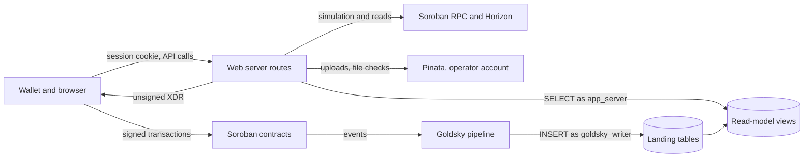

# Threat model: app and indexer tier

This page covers the parts of Tribe Builder that sit between people and the contracts: the web app's server routes (`apps/web`), the Goldsky pipeline (`packages/goldsky`) and the PostgreSQL read model (`db/`). The contracts have their own security model in [`docs/SECURITY_MODEL.md`](../SECURITY_MODEL.md); this tier is out of scope for the contracts audit ([SCOPE.md](SCOPE.md)) and is the subject of a separate, smaller review.

It describes `dev` as of the commit in [SCOPE.md](SCOPE.md). Work in progress in other branches changes some of it; those places carry a TODO marker.

## The rule this tier is built on

**The chain is the authority; this tier is not.** The server holds no key that can move a member's or a DAO's assets, and it never signs or submits a transaction. Every value-bearing action is a transaction the member's wallet signs, and the contracts check it. The server's jobs are to show indexed data, to prepare unsigned transactions, to authenticate wallets for its own routes, and to pay for IPFS uploads. A failure in this tier can mislead a person, deny service, or cost the operator money; it should not be able to move funds without a wallet signature.

## System and trust boundaries

| Boundary | What crosses it | What it relies on |
| --- | --- | --- |
| Wallet to contracts | Signed transactions | The wallet's signature and the contracts' checks. Nothing in this tier is trusted |
| Browser to server | API calls with the session cookie | The session (below), the `Origin` check on preparation routes, and request validation |
| Server to Pinata | Upload grants and file checks, billed to the operator | The upload gate (below) |
| Contracts to indexer | Events from contracts the pipeline follows | The allowlists, which start from the Manager's own events |
| Indexer to read model | Rows in three landing tables | The `goldsky_writer` credentials, and the views' filters |
| Read model to server | Indexed state, read as `app_server` | Read-only access; chain re-reads on value-bearing paths |

## Assets

- **Members' and DAOs' on-chain assets.** Protected by wallet signatures and the contracts. This tier can prepare a transaction but cannot sign it.
- **The operator's paid services.** Pinata storage, bandwidth and API keys.
- **Server secrets.** `IRON_PASSWORD` (session and upload-token keys), `STELLAR_WEB_AUTH_SECRET` (the SEP-10 and SEP-53 challenge key), `PINATA_JWT`, `APP_DATABASE_URL`, `GOLDSKY_API_TOKEN`, and the pipeline's database credentials.
- **Read-model integrity.** What people see (DAOs, feeds, balances, listings) and which contract addresses the app prepares calls against.
- **Availability.** Shared views that every DAO's pages read.

## 1. What a session proves

A session is an encrypted `iron-session` cookie (`stellar-auth`; `httpOnly`, `sameSite=lax`, `secure` in production) that records an address, the network it signed in on, and the method used ([`lib/auth/server.ts`](../../apps/web/src/lib/auth/server.ts), [`lib/auth/types.ts`](../../apps/web/src/lib/auth/types.ts)). The wallet gets one by signing a server-issued challenge: SEP-53 message signing first, SEP-10 as the fallback ([`components/shell/wallet-session.tsx`](../../apps/web/src/components/shell/wallet-session.tsx)). Challenges are signed by the server key, bound to the configured network and app domain, and expire after 5 minutes ([`lib/auth/verification.ts`](../../apps/web/src/lib/auth/verification.ts)). SEP-10 sign-in reads the account's signers and threshold from Horizon, as described in [Application trust boundaries](../SECURITY_MODEL.md#application-trust-boundaries).

What a session lets a caller do:

- **Prepare unsigned transactions** for its own address: the `claims`, `marketplace`, `tokens` and `treasury` preparation routes under `app/api/dao/[daoId]/*/prepare`. The actor is the session's address, never a submitted one; the request's `Origin` must equal `APP_URL`; bodies are size-capped and validated. The result still needs the wallet's signature.
- **Read its own views:** the dashboard, and marketplace and treasury readiness and inventory for its address.
- **Use the upload routes** (section 2).

What a session does not do: it grants no on-chain authority, does not show that the account is funded or able to transact, and is not a shared or revocable server record. Logout clears the cookie in that browser.

TODO: the sign-in checks and the session's lifetime and revocation are being revised. Describe the final rules here, and in `SECURITY_MODEL.md`, when that work merges.

## 2. The cost of uploads

Uploads to IPFS go through the operator's Pinata account, so each one costs the operator. Every upload route (`/api/pinata/generate-jwt`, `/api/pinata/pin-cid`, `/api/uploads/pinata-url`, `/api/uploads/complete`) passes one gate, `requireUploadAccount` in [`lib/upload-access.ts`](../../apps/web/src/lib/upload-access.ts):

1. a session on the deployment's network;
2. a per-account limit per route in a 10-minute window: `generate-jwt` 10, `pin-cid` 10, `pinata-url` 30, `complete` 30;
3. the account must exist on that network, from canonical Horizon. A failed or timed-out lookup refuses; it never passes. A funded result is remembered for 10 minutes and an unfunded one for a minute.

What this bounds, and what it does not:

- **The unit of cost is an account.** A key costs nothing, but a funded account holds the base reserve on mainnet. On testnet, Friendbot funds accounts for free, so there the funded check costs an abuser one Friendbot call per key.
- **There is no deployment-wide upload budget,** and the limits and the funded cache are kept per server instance (section 5).
- **Upload tokens** are HMAC-signed with a key derived from `IRON_PASSWORD` under its own label ([`lib/pinata-upload-auth.ts`](../../apps/web/src/lib/pinata-upload-auth.ts)). A token names the account it was issued to, the upload type, the allowed MIME types, a size limit and an expiry; only that account completes it, until it expires. It is not single-use and does not name a CID.
- **`complete` and `pin-cid` only read.** The CID must already be a file in the operator's Pinata account, and `complete` checks its size against the token. Neither pins a CID the client names.
- **`generate-jwt`** creates a Pinata key for one legacy `pinFileToIPFS` upload. The key has no expiry and no size cap of its own; the 100 MB folder limit is checked in the browser.
- **Signed upload URLs** from `pinata-url` expire after 30 minutes and carry per-type size caps.

The operator's remaining controls are Pinata's own account limits and spend alerts.

## 3. The indexer's trust in outside modules

The pipeline ([`packages/goldsky/pipelines/builder-stellar-events.yaml`](../../packages/goldsky/pipelines/builder-stellar-events.yaml)) follows contracts through append-only allowlist tables in the `streamling` schema:

- The Manager's address is fixed in the pipeline. The DAO's core contracts and its Manager-deployed modules (`auction`, `marketplace`, `claims`) enter the allowlists only from the Manager's `DaoCreated` and `ModuleCreated` events.
- `streamling.dao_modules` takes any contract that a followed Token reports in `ModuleRegistered`. After launch a DAO can register any contract by proposal, so this list can hold code the Manager never deployed.

The read model ([`db/migrations/0002_manager_views.sql`](../../db/migrations/0002_manager_views.sql)) gives a registration a known role only if the Manager deployed that contract as that kind (`manager.manager_modules`); every other registered contract has the role `module`. A `module`'s events are indexed under its DAO, inside its registration window, with `admin` visibility in the feed. They stay out of the domain views (auctions, pools, listings, claim lists) and out of `manager.daos`. Views that cast event fields read only Manager-deployed roles (`chain.try_int`, migration 0012), and `chain.u64_bigint` reads `u64` values past the bigint range as the bigint maximum (migration 0013), so one contract's malformed or extreme values cannot stop a shared view from reading. Windows are per DAO, so one DAO's registrations do not add rows to another DAO's views.

What remains is in [KI-15 and KI-16](KNOWN_ISSUES.md#ki-15-outside-modules): an outside module can fill its own DAO's admin feed with noise, rows already indexed stay, and the remedy is to unregister it by vote or remove its allowlist row.

TODO: read-model changes in progress (migration 0015) tighten how a registration's role is assigned. Update this section when they merge.

## 4. The `goldsky_writer` role

The pipeline writes to PostgreSQL as `goldsky_writer` ([`db/setup-roles.sh`](../../db/setup-roles.sh), [`db/grant-permissions.sh`](../../db/grant-permissions.sh)).

- **Tables it writes.** `SELECT`, `INSERT` and `UPDATE` on the three landing tables: `chain.raw_events`, `chain.decoded_events` and `app.activity_feed_events`. A trigger makes them append-only: it rejects any `UPDATE` that changes a row and every `DELETE` ([`db/migrations/0001_landing_tables.sql`](../../db/migrations/0001_landing_tables.sql)). Re-delivering an identical row is allowed, so the pipeline can retry.
- **Everything else is a view** over those tables, so whatever the writer inserts is what every view and page reads.
- **The web app** connects as `app_server`, which has `SELECT` on the view schemas only, no access to `chain`, and no `SELECT` on `app.activity_feed_events`.

So the writer's credentials are a trust root for display: whoever holds them can append rows that the views will show, though not change or remove rows already there. They cannot touch the chain. This is why the value-bearing paths re-read chain state (section 6), and why the read model is never the authority for a transaction.

TODO: the database roles' grants and the setup scripts are being hardened. List the final grants for both roles here when that work merges.

## 5. Replay and rate-limit state per instance

Server-side bookkeeping lives in each server instance's memory, not in a shared store:

- the SEP-53 and SEP-10 challenge set that stops a signed challenge from being used twice ([`lib/auth/server.ts`](../../apps/web/src/lib/auth/server.ts));
- the sign-in rate limits ([`lib/auth/rate-limit.ts`](../../apps/web/src/lib/auth/rate-limit.ts)), keyed by route and the client IP the platform reports;
- the upload limits and the funded-account cache (section 2);
- read caches for DAO configuration, artwork and claim trees ([`lib/server-cache.ts`](../../apps/web/src/lib/server-cache.ts), [`lib/minter/claim-list.ts`](../../apps/web/src/lib/minter/claim-list.ts)).

On a platform that runs several instances, each counts on its own. A challenge consumed on one instance is not known to another until it expires (5 minutes), and a limit of N per window is N per instance. `SECURITY_MODEL.md` states this: the reference does not claim a shared replay store. The session itself is in the client's cookie, so it does not depend on which instance serves a request.

TODO: moving this state to a shared store, and which client IP headers are trusted, are being revised. Update this section when that work merges.

## 6. What the app re-reads from chain

Addresses and discovery come from the read model; the chain is re-read where a prepared transaction moves value:

| Path | From the read model | Re-read on chain before preparing |
| --- | --- | --- |
| Claims ([`lib/minter/service.ts`](../../apps/web/src/lib/minter/service.ts)) | The DAO's configuration | The ClaimMinter the Token's registry names (`token.module("claims")`); the list, payment asset, allowance and root; the claimer's record. The claim list file is rebuilt and its root must equal the chain's. Root, price and progress are checked again after simulation |
| Marketplace ([`lib/marketplace/actions.ts`](../../apps/web/src/lib/marketplace/actions.ts)) | The Marketplace contract and whether it is live | Its wiring (`get_config`) against the indexed Token and Treasury and the configured Manager; the token's owner; the live listing or pool, which must match the indexed one |
| Treasury funding ([`lib/treasury-service/funding.ts`](../../apps/web/src/lib/treasury-service/funding.ts)) | The Treasury and Governor | `treasury.governor()` against the indexed Governor; balances before and after simulation |
| Holder actions ([`lib/token-holder/actions.ts`](../../apps/web/src/lib/token-holder/actions.ts)) | The DAO's contracts | The token's current owner and the Token's settings |
| Proposals | The Governor, Token and Treasury addresses | The browser builds and simulates `propose` itself; there is no server preparation route |

Display text is checked against the chain where the chain holds a hash: the DAO profile is shown only when the indexed text hashes to Metadata's `profile_hash()`.

## Questions for the review

1. Can a session, a prepared transaction or any server route cause a wallet to sign something other than what the person was shown?
2. Is every value-bearing preparation path's chain re-read enough, given that the read model can be wrong (a stale index, an outside module, or a leaked writer credential)?
3. Do the upload gate and Pinata's own limits bound the operator's cost in practice, including on testnet?
4. Can one DAO, or one outside contract, change what another DAO's pages show, or stop shared views from reading?
5. Do the per-instance replay and rate-limit stores hold up on the hosting platform actually used?
