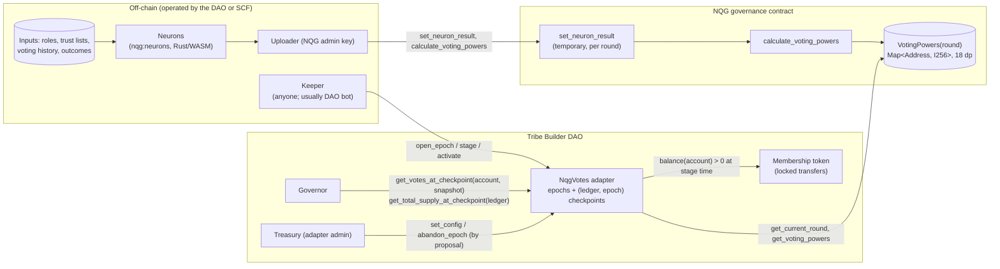

# Design: Neural Quorum Governance (NQG) compatibility

This is the compatibility specification for the SCF #44 Tranche 2 deliverable: "Written compatibility specification and an adapter contract for the available SDF NQG testnet contract that demonstrates how vote-power attribution and quorum logic would plug into Builder-launched DAOs". It covers what NQG exposes on-chain, where it is deployed, how a Tribe Builder Governor can take its votes from NQG through an adapter, and what an adopting DAO must run off-chain. The adapter contract, and the Governor's configurable vote source it plugs into, are built separately (`feat/governance-adapter`). This document fixes the interface they share.

The award marks this work as best-effort and contingent on upstream readiness. §2 shows that upstream is only partly ready, and §8 lists what we need from SDF/SCF.

Sources:

- SCF contracts: `github.com/stellar/stellar-community-fund-contracts`, `main` at `c9db8e8`. Paths below are relative to that repository and written as `nqg:<path>:<line>`. The SCF token and the SCF Governor fork were deleted from `main` in `b4eada0` ("Delete not used/experimental code from main", 2026-10-28). They are cited from the commit before it as `nqg@b4eada0~1:<path>:<line>`, and still exist on the `development` branch.
- SCF handbook: *Neural Quorum Governance*, *Components & Parameters*, and *Public Goods Award, Official Rules* (stellar.gitbook.io/scf-handbook).
- Our Governor: `contracts/governor/src/contract.rs` in this repository, cited as `governor:<line>`. OpenZeppelin's `Votes` trait comes from `stellar-contracts` at `fbfde38`, `packages/governance/src/votes/mod.rs`, cited as `oz-votes:<line>`.

## 1. What NQG exposes on-chain

### 1.1 The governance contract (`VotingSystem`)

One admin-gated contract stores the neural-governance set-up, the per-round neuron results, the final voting powers, and the submission votes and tallies.

| Concern | Entry points | Notes |
|---|---|---|
| Rounds | `get_current_round`, `set_current_round(round)` (`nqg:contracts/governance/src/lib.rs:87-99`) | A plain admin-set `u32`. It is not tied to ledgers or time, and the admin can set it to any value, including an earlier one. |
| Neuron set-up | `add_layer(neurons: Vec<(name, weight)>, aggregator)`, `remove_layer`, `get_layer`, `get_neuron`, `get_neural_governance` (`lib.rs:246-296`, `lib.rs:407-409`) | Layers are aggregated with `Sum` or `Product` (`nqg:contracts/governance/src/neural_governance.rs:9-14`). Weights are `I256` with 18 decimals. |
| Neuron result submission | `set_neuron_result(layer_id, neuron_id, result: Map<Address, I256>)` (`lib.rs:315-330`) | Admin only. Written for the **current round** into **temporary** storage (`nqg:contracts/governance/src/storage.rs:71-80`), so raw neuron results expire. |
| Final voting power | `calculate_voting_powers()` (`lib.rs:361-400`), then `get_voting_powers()` and `get_voting_power_for_user(user)` (`lib.rs:402-404`, `lib.rs:215-225`) | The weighted layer results are summed. The value is clamped to `>= 0` **only on the last layer** (`lib.rs:385-389`). Every layer must cover the same set of users (`lib.rs:373-377`, `lib.rs:394-396`). The result is one `Map<Address, I256>` per round in persistent storage (`storage.rs:130-141`). Recalculating overwrites it. |
| SCF voting | `set_submissions`, `set_votes_for_submission(submission, Map<Address, Vote>)`, `tally_submission` (`lib.rs:102-205`) | `Vote` is `Yes`, `No`, or `Abstain` (`nqg:contracts/governance/src/types.rs:28-34`). Quorum delegation is resolved off-chain before upload (§5). |
| Admin | `transfer_admin`, `upgrade(wasm_hash)` (`lib.rs:228-242`) | A single admin address, which can upgrade the contract. |

Two properties decide the adapter design:

1. **There are no historical reads.** Both voting-power getters read `CurrentRound` (`lib.rs:216`, `lib.rs:403`). The storage key is per round (`storage.rs:130`), but no public function takes a round. Once the admin moves the round on, the previous round's powers can't be read through the interface. Nothing is keyed by ledger.
2. **NQG emits no events.** Nothing marks "round N is final". `calculate_voting_powers` can run again and overwrite the round's powers at any time.

### 1.2 The voting-power unit

The power is a fixed-point `I256` with 18 decimals (`DECIMALS = 10^18`, `lib.rs:37`, and `nqg:neurons/src/types.rs:3`). In SCF the score is human-scale, a sum of five neuron outputs (*Components & Parameters* §1.3):

- Assigned Reputation: 0 to about 4, from tier and Discord roles.
- Voting History: 0 to 3, a logistic bonus.
- Vote Quality: −5 to 5, a logistic bonus.
- Trust Graph: 0 to about 3, or more with the highly-trusted bonus.
- Trust Loss: 0 or negative.

Typical scores run from a few points to the low twenties. Individual neurons can be negative. The final per-round power is clamped at 0 (`lib.rs:385`).

The power is **per round, not historical at a ledger.** The off-chain neurons compute each round's power from the full history (`nqg:neurons/src/lib.rs:20-113`). On-chain, a round is a snapshot with no ledger attached.

### 1.3 The SCF token's `Votes` implementation (deleted)

SCF built exactly the bridge we need, a non-transferable token whose balances mirror NQG powers, and then removed it from `main`:

- `scf_token` implements **Script3's** `Votes` trait (`total_supply`, `get_past_total_supply`, `get_votes`, `get_past_votes`, `set_vote_sequence`, `get_delegate`, `delegate`), copied in at `nqg@b4eada0~1:contracts/scf_token/src/votes.rs:1-56`. It does **not** implement OpenZeppelin's `Votes` trait, which our Governor calls. The method names and return types differ (`i128` against `u128`).
- `update_balance(address)` is admin-only and pulls one user at a time from `get_voting_power_for_user`. It clamps negative values to 0 and rescales from 18 to 9 decimals (`contracts/scf_token/src/contract.rs:37-91`, `:116-132`). A cap of 200 accounts (`MAX_ACCOUNTS_COUNT`, `contract.rs:17`) bounds the address list.
- History is **one checkpoint deep**: `Balance { current, previous, updated_ledger, updated_round }` (`contracts/scf_token/src/balance.rs:8-26`) and `TotalSupply { current, previous, updated }` (`contracts/scf_token/src/storage.rs:7-23`). `get_past_votes` and `get_past_total_supply` return `previous` if the update came after the queried ledger, and `current` otherwise (`contract.rs:143-181`). The code comment accepts this because rounds are monthly and longer than any voting period.
- **This is a defect we must not copy.** The total supply is rewritten on every per-user update (`contract.rs:72-84`). Users are updated one transaction at a time, so a round's sync spans many ledgers. For a ledger before the sync, `get_past_total_supply` returns the total after only the *first n−1* updates, not the previous round's total. A proposal snapshotted during or before a sync can get a quorum denominator that matches no round.
- `delegate` panics, and `get_delegate` returns the account itself (`contract.rs:183-189`).

SCF's Governor fork (`nqg@b4eada0~1:contracts/governor/README.md`) is Script3's Soroban Governor with three changes: council proposals are disabled, settings proposals are council-only, and a proposal-creation whitelist lets Pilots propose from a secondary address so their voting address stays anonymous.

## 2. Deployments (checked read-only on 2026-11-18)

| What | Network | ID | Status |
|---|---|---|---|
| NQG governance contract, as linked from the handbook | Mainnet | `CDHNQUWHWMWYH6PZROOQSLV62APR5AEPR2NRQXX2LHBIUXHGURH3R52M` | **Live but stale.** The instance is on the ledger (wasm `c1ba1255…22bf6`). `CurrentRound` is **28** and `CurrentLayerId` is 2. Its interface is the older one: `initialize` rather than a constructor, `get_submissions -> Vec<String>`, `update_layer`, and **no** `get_voting_power_for_user`. SCF has run rounds up to #44 since then, so current rounds are computed elsewhere: another contract, or off-chain. |
| SCF Public Goods Award Governor, as linked from the Official Rules | Testnet | `CCT2UWMPL3R7Z5FTN6DZJ7JAC62QEPPGGN7OXG3IBH6OTVLBHE3UCOC5` | **Gone.** RPC returns "Contract not found". It was most likely removed by a testnet reset. Its votes token, presumably an `scf_token`, could not be traced. |
| NQG governance contract or SCF token | Testnet | none published | We found none in the repository (`examples/env.example` leaves `NEURAL_GOVERNANCE_ADDRESS` and `SCF_TOKEN_ADDRESS` empty), the handbook, or a web search. |

Method: `stellar contract info interface` and `stellar contract read --key-xdr AAAAFA==` (the instance key) against `soroban-testnet.stellar.org` and a public mainnet RPC. stellar.expert's API now needs payment, so it wasn't used. We made no writes.

**Consequence:** no "available SDF NQG testnet contract" exists to integrate against today. The demonstration therefore deploys SCF's own governance wasm, built from `main` at `c9db8e8`, to testnet, seeds it with the example neuron outputs (`nqg:examples/data/neurons_output.json`) using the scripts in `nqg:examples/scripts/`, and points the adapter at it. The adapter depends only on `get_current_round` and `get_voting_powers`, which both the old and new interfaces have, so it will work against an SDF deployment when one appears. See §8, Q1.

## 3. Can a Builder Governor take its votes from NQG?

### 3.1 What the Governor reads

The Governor reads the DAO token through OpenZeppelin's `VotesClient` and one Builder-specific method:

| Call site | Method | Semantics we rely on |
|---|---|---|
| `propose`, proposer threshold (`governor:687-693`) | `get_votes_at_checkpoint(proposer, seq − 1)` | Historical power at the snapshot ledger, which is the previous ledger. |
| `cast_vote` weight (`governor:799-806`) | `get_votes_at_checkpoint(voter, proposal.vote_snapshot)` | The same snapshot ledger for every voter. Weight 0 is rejected (`ZeroVotingWeight`). |
| `quorum(ledger)` view (`governor:604-609`) | `get_total_supply_at_checkpoint(ledger)` | The quorum denominator at a ledger. |
| `quorum_now`, stored on the proposal (`governor:376-380`) | **`NftClient::voting_supply_at_previous_ledger()`** | **Not part of `Votes`.** It is the token-specific voting supply at `seq − 1`. |
| `set_proposal_threshold` guard (`governor:262-267`) | `get_total_supply()` | The current total. |

OpenZeppelin requires `ledger < current` (`FutureLookup`, `oz-votes:102`, `oz-votes:137`, enforced in `storage.rs:128` and `:167`). Quorum is `ceil(supply × bps / 10 000)` and is 0 if the supply is 0 (`governor:382-394`). `proposal_threshold` must be at least 1 (`governor:442-446`).

### 3.2 Verdict

**Yes.** An adapter contract can implement `get_votes_at_checkpoint`, `get_total_supply_at_checkpoint`, `get_total_supply`, and `get_votes` over NQG scores, with the OpenZeppelin `Votes` signatures unchanged. It must **own its history**, though. It can't forward reads to NQG, because NQG has only a current round and no ledger axis (§1.1). Item by item:

| Concern | What breaks if forwarded naively | Resolution in the adapter |
|---|---|---|
| **Snapshot semantics** | `get_votes_at_checkpoint(a, L)` would return the power for *whatever round is current now*, not at `L`. A round change or a recalculation during a vote would change the weight of votes not yet cast. | The adapter keeps epochs. Each copies one NQG round, and a `(ledger, epoch)` checkpoint marks when it became active. A read at `L` uses the epoch active at `L`. |
| **Quorum as a share of total supply** | NQG has no total, and summing the map at read time costs O(users) per call. SCF's token got the total wrong across a multi-ledger sync (§1.3). | The epoch total is accumulated while staging and published **atomically** with the epoch's activation, so every ledger maps to exactly one consistent `(powers, total)` pair. |
| **Negative powers** | `I256` into `u128` would trap, or wrap if cast carelessly. Intermediate layers can be negative, and the final clamp lives in NQG code that an upgrade could change. | Clamp `< 0` to 0 in the adapter whatever NQG does. Use checked conversion, and fail staging rather than wrap. |
| **Fractional powers** | The Governor's units are integers (one NFT is one vote). An 18-decimal score doesn't fit the UI's assumptions, and `I256` doesn't fit `u128` without scaling. | Scale `10^18` to `10^decimals` with floor division. `decimals` defaults to 9, which matches SCF's token (`contract.rs:16-18`). The adapter exposes `decimals()`. Threshold and quorum are in these units, and the UI must format them. |
| **Round finalised after a proposal's snapshot** | Ambiguous: a proposal could vote on round N's powers but be counted, or have its quorum computed, on N+1's. | It's well defined. A proposal always uses the epoch active at its `vote_snapshot`. A later activation affects only later proposals. This is the intended behaviour, matching token voting, where buying after the snapshot doesn't count. |
| **No epoch yet** | Not applicable | Everything reads 0 before the first activation. Since `proposal_threshold >= 1`, nobody can propose, and since weight 0 is rejected, nobody can vote. The DAO is safely inert until its first activation. |
| **`quorum_now` calls a non-`Votes` method** | The Governor would trap on an adapter that doesn't implement `voting_supply_at_previous_ledger`. | Preferred: the vote-source work changes `quorum_now` to call `get_total_supply_at_checkpoint(seq − 1)` for non-NFT sources. Fallback: the adapter also exposes `voting_supply_at_previous_ledger() -> u128` with exactly that meaning. The adapter implements both, so either Governor shape works. |
| **Delegation** | NQG's quorum delegation is a per-vote, per-submission choice resolved off-chain (`nqg:neurons/src/quorum.rs:29-104`). It doesn't map onto OpenZeppelin's one-delegate-per-account model. | Unsupported: `delegate` panics with `ActionNotSupported`, and `get_delegate(a)` returns `Some(a)`, so every account votes its own power. Quorum delegation inside a Builder DAO is out of scope (§8, Q6). |

We keep the trait shape **unchanged**, because nothing found here justifies changing it. All the semantic differences can be absorbed inside the adapter. The only Governor change we ask for is removing the NFT-specific call in `quorum_now`.

## 4. Recommended adapter design (`NqgVotes`)

### 4.1 Model

An **epoch** is the adapter's frozen copy of one NQG round, filtered by the membership gate (§6) and scaled. An epoch moves through three states:

- **Open:** created by `open_epoch`, which records the NQG round, the NQG map's length, and a hash of its XDR.
- **Staged:** `stage` has consumed every map entry in order.
- **Active:** `activate` appends the `(ledger, epoch)` checkpoint.

Because staging walks the map **by cursor, in map order**, nobody chooses which accounts to include. A permissionless caller can't produce a partial epoch, and anyone can finish a sync. Re-checking the hash on every `stage` call detects a recalculation by NQG mid-sync, and the epoch must then be reopened.

### 4.2 Interface

OpenZeppelin `Votes` (`#[contractimpl(contracttrait)]`, same signatures):

```rust
fn get_votes(e, account) -> u128;                             // epoch active now
fn get_votes_at_checkpoint(e, account, ledger: u32) -> u128;  // FutureLookup if ledger >= seq
fn get_total_supply(e) -> u128;
fn get_total_supply_at_checkpoint(e, ledger: u32) -> u128;    // FutureLookup if ledger >= seq
fn get_delegate(e, account) -> Option<Address>;               // Some(account)
fn delegate(e, account, delegatee);                           // panics ActionNotSupported
```

Builder compatibility and metadata:

```rust
fn voting_supply_at_previous_ledger(e) -> u128;  // = get_total_supply_at_checkpoint(seq - 1)
fn decimals(e) -> u32;
fn name(e) -> String;                             // e.g. "<DAO> NQG votes", for the UI
fn active_epoch(e) -> Option<EpochInfo>;
fn epoch(e, id: u32) -> Option<EpochInfo>;        // { nqg_round, total, entries, staged, activated_ledger }
fn config(e) -> Config;
```

Sync. Mutating calls are permissionless unless noted:

```rust
/// Starts epoch `last + 1` from NQG's current round. Fails if NQG's round is
/// not newer than the last activated epoch's round (unless `allow_same_round`,
/// governance-only, for re-staging after a membership change).
fn open_epoch(e) -> u32;
/// Processes the next `max` entries of NQG's `get_voting_powers()` map:
/// clamp at 0, scale, apply the gate, write `Power(epoch, account)`, add to the
/// running total. Fails `SourceChanged` if NQG's round or map hash differ from
/// those recorded at `open_epoch`.
fn stage(e, epoch: u32, max: u32) -> u32;   // returns entries remaining
/// Requires staged == entries and `now >= staged_at + activation_delay`.
/// Appends Checkpoint { ledger: seq, epoch }; the epoch counts from the next
/// ledger onwards (reads are always at ledgers < seq).
fn activate(e, epoch: u32);
/// Governance (DAO Treasury) only.
fn set_config(e, config: Config);
fn abandon_epoch(e, epoch: u32);          // drop an open, unactivated epoch
```

### 4.3 Storage

| Key | Type | Storage | Notes |
|---|---|---|---|
| `Config` | `{ source: Address, decimals: u32, membership_token: Option<Address>, activation_delay: u64, admin: Address }` | instance | `admin` is the DAO Treasury, so configuration changes go through a proposal. |
| `EpochCheckpoints` | `Vec<(u32 ledger, u32 epoch)>`, append-only | persistent, one entry | One entry is appended per round. At monthly rounds this grows by 12 a year. A binary search serves `*_at_checkpoint`, and a fast path checks the last element first. |
| `Epoch(id)` | `{ nqg_round, map_hash: BytesN<32>, entries, cursor, total: u128, staged_at, activated_ledger }` | persistent | |
| `Power(epoch, account)` | `u128` | persistent | Only nonzero powers are written. An absent key reads as 0. |

TTL: the renewal sweep must keep `Power` and `Epoch` entries of the **active epoch and the previous one** alive. A proposal snapshotted just before an activation still reads the previous epoch until its vote ends, and voting and queue periods are capped at 30 days each (`MAX_VOTING_PERIOD`, `MAX_QUEUE_DELAY`). Older epochs may archive, and reading them then needs a restore, the same caveat the Governor's `quorum` view already carries (`governor:600-603`).

### 4.4 Cost bounds

- NQG keeps a whole round in a single `Map<Address, I256>` ledger entry, so the round size is bounded by the network's contract-data entry size limit. On current settings that is a few hundred to roughly a thousand accounts. Each `stage` call reads the whole map once, cross-contract. The number of writes per transaction bounds `max`, so batches of about 50 accounts are a safe default. The adapter's keeper should size `max` by simulating first.
- The map's ordering is deterministic (Soroban `Map` keys are sorted), so the cursor walk is stable as long as the hash is unchanged.
- Reads during voting are O(log epochs) plus one `Power` read, which is cheaper than the NFT token's per-account checkpoint search.

### 4.5 Failure modes

| Failure | Effect | Handling |
|---|---|---|
| NQG recalculates or changes round mid-staging | Hash or round mismatch | `stage` fails with `SourceChanged`. Abandon the epoch and open a new one. A partial epoch can't be activated. |
| NQG admin rolls `CurrentRound` back | `open_epoch` sees a round that isn't newer | Rejected unless governance sets `allow_same_round`. |
| NQG upgraded to an incompatible interface | `stage` traps | Already-active epochs keep working, because reads never touch NQG. Governance repoints `source` with `set_config`. |
| NQG never publishes a new round | The epoch goes stale | Voting continues on the last epoch. This is a governance and liveness issue, not a safety one. The UI should show the epoch's age. |
| Malicious or compromised NQG admin | Arbitrary powers | **Trusted input**, by design, since NQG's admin writes the neuron results (`lib.rs:315-330`). Mitigations: `activation_delay` (for example 72 hours) gives members a window to inspect a staged epoch and pass a proposal calling `abandon_epoch`. Point `source` only at an NQG instance whose admin the DAO accepts (§7). |
| Power overflow on scaling | Not applicable | Checked arithmetic: `stage` fails rather than truncating high bits. |
| No epoch yet | Inert DAO | §3.2. The UI must show "voting starts after the first NQG round is synced". |
| Archived old epoch | A historical read fails | Restore the entries. Live proposals are covered by the TTL policy in §4.3. |
| Snapshot ledger equals the activation ledger | Not applicable | Activation at ledger `S` means the epoch is active for reads at ledgers `>= S`. The Governor snapshots at `seq − 1`, so a proposal created in ledger `S + 1` is the first to see the new epoch. Tests must pin this boundary. |

## 5. Integration



Lifecycle of one round:

1. The DAO's data pipeline collects the inputs, and the neurons compute per-user scores off-chain.
2. The NQG admin uploads each neuron's results and calls `calculate_voting_powers`.
3. A keeper calls `open_epoch`, `stage` repeatedly, and then `activate` once `activation_delay` has passed.
4. Proposals created from the next ledger onwards snapshot the new epoch. Proposals already open keep the old one.

## 6. Membership: gate or replace?

The SCF plan says NQG DAOs use soulbound membership tokens. In Builder terms that is a Token with `transfers_locked` (and usually `members_only_delegation`) set, per [locked-tokens](locked-tokens.md).

**Recommendation: NQG power *replaces* token voting, *gated* by holding the membership token.** The Governor points at the adapter, not the Token, and an account's vote weight is its NQG score if it is a member, and 0 otherwise.

Why gate:

- NQG scores are attributed by whoever runs the neurons. With SCF's instance, that covers every SCF participant, not this DAO's members. Without a gate, any SCF Pilot could vote in every NQG-backed tribe.
- The membership token stays the DAO's own admission control: who's in, recovery, and removal by vote. NQG decides *how much* a member's voice weighs, and the token decides *whether* they have one.

Why replace rather than combine:

- Token votes (whole NFTs) and NQG scores are different units. Summing or multiplying them makes one dominate, depending on scale, and invites buying power into a reputation system.
- With locked transfers, every member holds one token, so token voting would be one-member-one-vote, and NQG is precisely the refinement of that. A DAO that wants a floor can ask its neurons to give every member a base score, which keeps the logic in one auditable place.

How the gate is applied: at **stage time**, an account with `token.balance(account) == 0` is written as 0 and isn't added to the total. So the quorum denominator counts only gated members. We don't re-check at read time:

- The NFT token keeps no balance history, only vote checkpoints, and those move with delegation. A read-time check of the *current* balance would let membership changes mid-vote alter weights.
- On a locked token, membership changes only by DAO action, so stage-time gating is exact between syncs.

After admitting or removing members, the DAO re-stages the same round (`open_epoch` with `allow_same_round`, governance-only) to refresh the gate. The UI offers this as a follow-up action on membership proposals.

**Requirement:** the Manager and UI must allow the NQG vote source only on Tokens with `transfers_locked = true`. On a transferable token, a stage-time gate could be gamed by buying a token before a sync.

## 7. Requirements for DAOs adopting NQG

On-chain configuration, set at creation or by proposal:

1. The membership Token has `transfers_locked` and `members_only_delegation` set.
2. An `NqgVotes` adapter is deployed with `source` (an NQG governance contract), `decimals` (default 9), `membership_token`, `activation_delay` (default 72 hours), and `admin` set to the DAO Treasury.
3. The Governor's vote source is the adapter, `proposal_threshold` is in adapter units (for example `1 × 10^9` means a score of 1.0), and `quorum_bps` is chosen against the expected total score. SCF's soft launch used 18.2% of the total NQG score, with a 51% to 66% approval threshold.
4. The first epoch is activated before launch, or the DAO launches inert (§3.2).

Choose one NQG source:

- **(A) Reuse SCF's scores.** Point `source` at SDF's NQG instance. This needs SDF to keep a current-round contract live and documented (§8, Q1 and Q2), and it makes SDF's admin a trusted party for the DAO's voting power. It fits DAOs whose members are SCF participants.
- **(B) Run your own NQG.** Deploy SCF's governance wasm with the DAO's own admin and neurons. This is the general case, and it needs the off-chain stack below.

Off-chain infrastructure for (B):

| Component | What it does | Who runs it |
|---|---|---|
| Data collection | Gathers the neuron inputs. SCF uses Discord roles, verified tiers, per-round trust lists, voting history, and award outcomes (`nqg:neurons/src/lib.rs:21-33`). A tribe defines its own. A minimal set is roles and tenure plus a trust list. | The DAO, or a service provider. |
| Neuron runner | Runs the neuron crate (Rust, also compiled to WASM for JavaScript, `wasm_bindgen` at `lib.rs:16-20`) and emits fixed-point results per neuron. | The DAO's operator. |
| Uploader | Holds the NQG admin key. It calls `set_current_round`, `set_neuron_result` per neuron, and `calculate_voting_powers`. These are admin-only, so this key is the trust root for voting power. Store it in a multisig or smart wallet controlled by the DAO's council. | The DAO's operator. |
| Keeper | Calls `open_epoch`, `stage`, and `activate` on the adapter. It is permissionless, so the platform can run one keeper for all tribes. | The Tribe Builder platform, or anyone. |
| Privacy | SCF keeps neuron inputs off-chain to avoid linking people to keys (`nqg:examples/README.md`, "Why not upload all data"). Published per-neuron results still reveal each address's score components. | DAO policy. |

Bounds to respect: about 1,000 accounts per NQG round (§4.4). Rounds should be much longer than voting delay plus voting period. Neuron results are in temporary storage, so upload and `calculate_voting_powers` must finish within one TTL window (`storage.rs:71-80`).

## 8. Open questions for SDF/SCF

1. **Where is the current NQG contract?** The mainnet contract the handbook links stopped at round 28, and the testnet Governor (`CCT2…OCC5`) no longer exists. Is there a maintained testnet (and mainnet) NQG instance, and is the "available SDF NQG testnet contract" in our award text one of them?
2. **Round history.** Would SDF add `get_voting_powers_round(round)` and `get_voting_power_for_user_round(user, round)`? The storage is already per round (`storage.rs:130`). This would let adapters sync a past round and recover from a missed window.
3. **Finality signal.** Could `calculate_voting_powers` emit an event carrying the round, entry count, and a hash, and could rounds be marked final so they can't be recalculated? Keepers could then sync on an event rather than polling, and the adapter's hash check would become a confirmation rather than a race.
4. **Scale limits.** SCF stores a round as one map entry. What is SCF's current voter count, and does SDF plan to shard the map (per-user keys) as it grows?
5. **SCF token and Governor.** Why were `scf_token` and the Governor fork removed from `main`? Is the Public Goods Award moving to a different vote source we should align with? Is SDF open to the OpenZeppelin `Votes` interface for cross-DAO reuse?
6. **Quorum delegation on-chain.** Is there a plan to move quorum resolution on-chain (`nqg:neurons/src/quorum.rs`)? Until then a Builder DAO gets neural power attribution, but not quorum delegation.
7. **Score reuse.** May third-party DAOs reuse SCF's NQG scores (option A in §7)? If so, under what terms and availability guarantees?
8. **Upgrades and admin.** The NQG admin can upgrade the contract (`lib.rs:236-241`). Would SDF commit to interface stability for `get_current_round` and `get_voting_powers`, or publish a versioned interface?

## 9. Out of scope

- An on-chain neuron runtime. NQG itself keeps neurons off-chain for privacy and cost.
- Mixed token-plus-NQG voting formulas (§6).
- The UI configuration flows for choosing the vote source, which are specified alongside the Governor vote-source work. This spec only constrains them: the NQG source is offered only on locked Tokens, units are formatted with the adapter's `decimals()`, and the epoch's age and "next sync" are shown.
